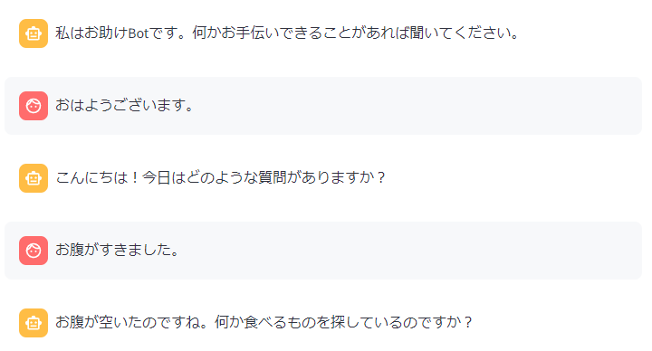
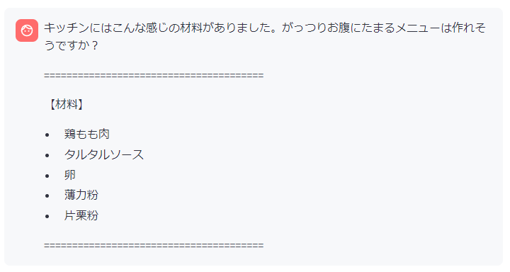
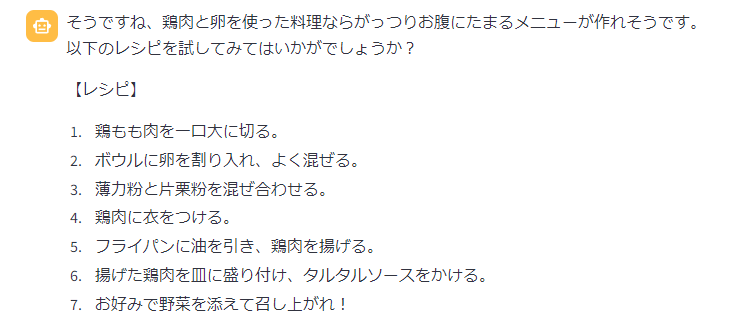
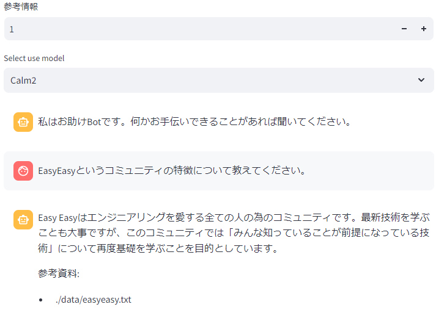
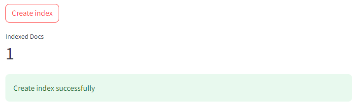
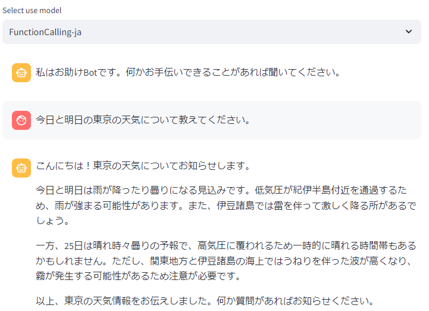

# LLM Chat Playbook

ローカルLLMを使ってチャット、RAG、Function Callingを試すサンプルコードです。LLMの推論にはOllamaを利用します。

## 書籍版のコード

- **最新版（2026年版以降）**: [mainブランチ](https://github.com/Sashimimochi/llm-chat-playbook/tree/main)
- **2024年版**: [GitHub Releases](https://github.com/Sashimimochi/llm-chat-playbook/releases) の `book-2024` を参照してください。現在、配布コードと一致するコミットの照合が必要なため、旧版リリースは公開準備中です。

書籍公開時点のコードは専用タグで固定し、公開済みタグの付け替えは行いません。

## Quick Start

DockerとDocker Composeが利用できる環境で、次を実行します。

```bash
make all
```

初回起動時は、`.env.example` に設定されたモデルをOllamaがダウンロードします。モデルの取得には時間とディスク容量が必要です。アプリは http://localhost:8053 で利用できます。

## Ollamaの設定

`.env` の `OLLAMA_INIT_MODELS` に、起動時に取得したいOllamaモデル名を空白区切りで指定します。初期値は `gemma4:e2b` と `gemma4:e4b` です。利用できるモデルはOllamaから動的に読み込みます。別のモデルを使う場合は、Ollamaのモデル名を設定してから起動してください。

コンテナ外でアプリを直接実行する場合は、`OLLAMA_BASE_URL` を利用するOllamaサーバーのURL（既定値: `http://localhost:11434`）に設定してください。

停止は `make down` で行えます。

## マルチターンチャット

会話履歴を利用して連続した会話を行えます。サイドバーでは温度、Top P、Top K、繰り返しペナルティ、最大生成トークン数を調整できます。





*画面例は旧版で撮影した参考画像です。モデル選択欄など、現行版とは表示が異なる場合があります。*

## RAG

参考情報を1以上にしてチャットを打つと、類似度の閾値を満たすドキュメントを参照して回答を生成します。



### インデックスデータの作成

`data` ディレクトリ配下にインデックスしたい `.txt` や `.pdf` を配置するか、セットアップで取得される `data/data.jsonl` を利用します。アプリの「Create index」ボタンを押し、インデックス作成が完了するまで待ちます。



大量のデータやサイズの大きいPDFをインデックスすると、メモリ不足で処理に失敗することがあります。

## Function Calling

天気について質問すると、モデルが必要に応じて天気APIを呼び出します。専用のチェックボックスで呼び出しを有効化する必要はありません。モデルがOllamaのツール呼び出しに対応している必要があります。天気を取得できる地域は `data/cities.json` に定義されています。



*画像は旧UIの参考例です。現行版ではモデルにツールを渡し、ツールを呼び出すかどうかはモデルが判断します。*

## 動作確認

Ollama APIクライアントのユニットテストは次で実行できます。

```bash
python -m unittest discover -s tests
```

## Released Models

別のモデルを扱いたいときは、[Ollama Library](https://ollama.com/library) から選択してください。すべてのモデルが日本語に対応しているわけではありません。

## Special Thanks

- https://weather.tsukumijima.net/
- https://easy2.connpass.com/
